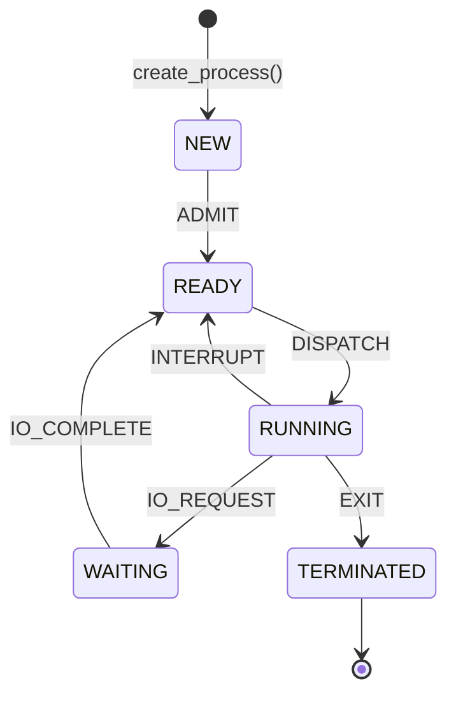

# PROCESS STATE TRANSITION SIMULATOR

### An Operating Systems Mini Project (Implemented in C)

| | |
|---|---|
| **Student name(s)**      | [Student 1 name], [Student 2 name] |
| **Register number(s)**   | [Register no. 1], [Register no. 2] |
| **Department**           | [Department] |
| **College**              | [College name] |
| **Academic year**        | [20XX - 20XX] |
| **Course**               | Operating Systems |
| **Guide / Faculty**      | [Faculty name] |
| **Module covered here**  | Member 1 - Process Logic & Simulation (C engine) |

---

## 1. Abstract

This project simulates the life cycle of a process in an operating system.
A process moves between five states - NEW, READY, RUNNING, WAITING and
TERMINATED - only through six legal actions. The simulation engine is written
in standard C11 as a reusable module: it creates processes with unique IDs,
validates every requested transition against a single rule table, rejects
illegal requests without changing any data, and keeps a log of all successful
transitions. A command-line program demonstrates the engine and an automated
test suite checks its behaviour. The engine is independent of any user
interface so that a separately developed web frontend can be connected later.

## 2. Introduction

In a multiprogramming system many processes compete for one or a few CPUs. The
operating system tracks each process's *state* and moves it between states as
events occur: a process is admitted, scheduled on the CPU, interrupted, blocked
for input/output, or finished. Understanding this *five-state process model*
is a core topic of operating systems courses (Silberschatz et al.; Stallings).
This project turns the model into working, testable software.

## 3. Problem Statement

Students often learn the process state diagram only as a picture. There is a
need for a small program that *enforces* the diagram: it must accept legal
transitions, refuse illegal ones with a clear reason, and show what has
happened so far.

## 4. Objectives

1. Model the five process states and six actions using C enumerations.
2. Create any number of processes (up to a documented limit) with unique, never-reused IDs.
3. Enforce exactly the six legal transitions through one central rule table.
4. Reject illegal requests safely, leaving state and history unchanged.
5. Record successful transitions in a transition history.
6. Verify behaviour with automated tests.
7. Keep the engine independent of the user interface for later integration.

## 5. Scope and Limitations

**Implemented**

- Process creation, five states, six transitions, validation, status codes.
- Global transition log and per-process transition record.
- Command-line demonstration and automated test suite.

**Limitations (deliberate, for a beginner-level project)**

- Fixed-size tables: 16 processes (`MAX_PROCESSES`), 128 log entries
  (`MAX_HISTORY`), 16 transitions per process (`MAX_PROCESS_TRANSITIONS`).
  When a history limit is reached the transition is rejected rather than
  overwriting old data. Terminated processes keep their slot until a reset.
- Only the *state machine* is simulated. There is no CPU scheduler, no real
  time, no time slices, no priorities, no memory model and no real I/O.
  The user (or test) chooses which action happens next.
- Single-threaded; no persistence of data between runs.
- No frontend or network integration is included in this module.

## 6. The Five Process States

| State | Meaning |
|---|---|
| **NEW** | The process has been created but not yet admitted to the pool of executable processes. |
| **READY** | The process is loaded and could run; it is waiting for the CPU. |
| **RUNNING** | The process is currently executing on the CPU. |
| **WAITING** | The process is blocked until an event (such as I/O completion) occurs. |
| **TERMINATED** | The process has finished. This is a final state. |

## 7. State Transition Table

| Current state | Action | Next state | Typical meaning |
|---|---|---|---|
| NEW | `ADMIT` | READY | The OS accepts the process for execution. |
| READY | `DISPATCH` | RUNNING | The scheduler gives the CPU to the process. |
| RUNNING | `INTERRUPT` | READY | The process is pre-empted (for example, its time slice ends). |
| RUNNING | `IO_REQUEST` | WAITING | The process asks for I/O and must wait. |
| WAITING | `IO_COMPLETE` | READY | The awaited I/O finishes; the process may run again. |
| RUNNING | `EXIT` | TERMINATED | The process completes. |

All other combinations are invalid.

## 8. State Transition Diagram



```
      +-----+  ADMIT   +-------+  DISPATCH  +---------+  EXIT   +------------+
 ---->| NEW |--------->| READY |----------->| RUNNING |-------->| TERMINATED |
      +-----+          +-------+            +---------+         +------------+
                         ^   ^                 |   |
                         |   +---- INTERRUPT --+   |
                         |                         | IO_REQUEST
                         | IO_COMPLETE             v
                         |                    +---------+
                         +--------------------| WAITING |
                                              +---------+
```

## 9. System Architecture

```
 +---------------------+   +--------------------+   +---------------------+
 | main.c              |   | test_simulator.c   |   | Future frontend     |
 | command-line demo   |   | automated tests    |   | bridge (not built)  |
 +----------+----------+   +---------+----------+   +----------+----------+
            |                        |                         |
            +------------------------+-------------------------+
                                     |  calls only the public interface
                         +-----------v------------+
                         |  process_simulator.h   |
                         +-----------+------------+
                                     |
                         +-----------v------------+
                         |  process_simulator.c   |
                         |  - rule table          |
                         |  - process table       |
                         |  - transition log      |
                         +------------------------+
```

Principle: **all rules live in the engine**; the demo, the tests and any
future frontend are only clients. The engine has no global variables and no
dynamic memory; the caller owns a `Simulator` structure.

## 10. Algorithm and Pseudocode

### Process creation

```
create_process(sim):
    if sim is NULL or output buffer too small:  return INVALID_ARGUMENT
    if sim.process_count == MAX_PROCESSES:      return TABLE_FULL
    p = next free row
    p.number = sim.next_id_number ; sim.next_id_number += 1   (never decreases)
    p.id     = "P" + p.number
    p.state  = NEW
    sim.process_count += 1
    return OK
```

### Transition

```
transition_process(sim, id, action):
    if sim or id is NULL:                  return INVALID_ARGUMENT
    if action not in 0..5:                 return INVALID_ACTION
    p = find process with this id
    if p not found:                        return INVALID_PROCESS_ID
    if (p.state, action) not in rule table: return INVALID_TRANSITION
    if log full or p's record full:        return HISTORY_FULL
    -- every check has passed; only now is anything modified --
    append (seq, id, p.state, action, next_state) to the global log
    remember the log index in p's record ; p.transition_count += 1
    p.state = next_state
    return OK
```

Validation always happens *before* modification; this is why a rejected
request cannot leave partial changes.

## 11. Data Structures Used

| Structure | Purpose |
|---|---|
| `enum ProcessState` | The five states (plus a `STATE_COUNT` sentinel). |
| `enum ProcessAction` | The six actions (plus `ACTION_COUNT`). |
| `enum SimStatus` | Result codes: success and six error kinds. |
| `struct Process` | ID, number, current state, creation sequence, transition count, indexes of its log entries. |
| `struct HistoryEntry` | Sequence number, process ID, previous state, action, new state, text description. |
| `struct Simulator` | Process table (array), history log (array), counters and logical clock. |
| `TransitionRule[]` (private) | The six-row rule table `{from, action, to}`. |
| `const char *[]` (private) | Name tables for states and actions. |

## 12. Implementation Details

- **Language/standard:** C11, compiled with `-Wall -Wextra -Wpedantic`.
- **Files:** `include/process_simulator.h` (interface), `src/process_simulator.c`
  (engine), `src/main.c` (demo), `tests/test_simulator.c` (tests).
- **Rule table:** a single `static const` array searched by
  `is_valid_transition()`. Adding or changing a rule means editing one row.
- **IDs:** the engine keeps a counter that only increases, so an ID is never reused.
- **Current state vs. history:** each `Process` holds its *current* state; the
  `Simulator` holds the *global log* of every successful transition. They are
  printed separately (`print_processes` / `print_transition_history`).
- **Safety:** `strcmp`-based lookup limited to used rows; every index is
  range-checked; `snprintf` is used for formatted text; no `malloc`/`free`.
- **Logical clock:** creations and transitions advance a counter used as the
  creation sequence number (no real-time timestamps).

## 13. Error Handling and Validation

| Situation | Status returned | Effect on data |
|---|---|---|
| NULL pointer / buffer too small / index out of range | `SIM_ERR_INVALID_ARGUMENT` | none |
| Unknown process ID | `SIM_ERR_INVALID_PROCESS_ID` | none |
| Action outside the six values | `SIM_ERR_INVALID_ACTION` | none |
| Legal action list violated (e.g. NEW + DISPATCH) | `SIM_ERR_INVALID_TRANSITION` | none |
| Process table full | `SIM_ERR_TABLE_FULL` | none |
| Global or per-process history full | `SIM_ERR_HISTORY_FULL` | none |

`get_status_message()` converts a code into readable text.

## 14. Test Cases and Test Results

Twenty-seven automated tests (the 21 required cases plus 6 extra) are listed
in `docs/test_cases.md`.

**Result of the run performed during development** (Linux, Ubuntu 24.04,
GCC 13.3.0, compiled with `-std=c11 -Wall -Wextra -Wpedantic`, no warnings;
the suite was also rebuilt with AddressSanitizer and UBSan and passed with no
reports):

```
Process State Transition Simulator - automated tests
----------------------------------------------------
[PASS] test_01_init
[PASS] test_02_first_process_is_P1
[PASS] test_03_unique_sequential_ids
[PASS] test_04_new_process_starts_in_NEW
[PASS] test_05_new_to_ready
[PASS] test_06_ready_to_running
[PASS] test_07_running_to_ready
[PASS] test_08_running_to_waiting
[PASS] test_09_waiting_to_ready
[PASS] test_10_running_to_terminated
[PASS] test_11_new_to_running_rejected
[PASS] test_12_ready_to_waiting_rejected
[PASS] test_13_waiting_to_terminated_rejected
[PASS] test_14_terminated_is_final
[PASS] test_15_unknown_process_id_rejected
[PASS] test_16_invalid_action_rejected
[PASS] test_17_rejected_does_not_change_state
[PASS] test_18_rejected_does_not_change_history
[PASS] test_19_processes_are_independent
[PASS] test_20_capacity_handled_safely
[PASS] test_21_reset_works_as_documented
[PASS] test_22_rule_table_has_exactly_six_rules
[PASS] test_23_history_records_details
[PASS] test_24_per_process_history_limit
[PASS] test_25_global_history_limit
[PASS] test_26_per_process_history_view
[PASS] test_27_names_and_messages
----------------------------------------------------
Tests run: 27, passed: 27, failed: 0
ALL TESTS PASSED
```

> **Note for the submission:** this run was not made on your Windows machine.
> Replace this block with the output of your own run before submitting.

## 15. Sample Program Output

Output of `simulator` from the same development run:

```
PROCESS STATE TRANSITION SIMULATOR - demonstration

=== Step 1: create two processes ===
  Created P1 and P2 (processes in table: 2)

=== Step 2: initial states ===
PROCESS TABLE (current state of each process)
+---------+------------+---------+-------------+
| PID     | State      | Created | Transitions |
+---------+------------+---------+-------------+
| P1      | NEW        |       1 |           0 |
| P2      | NEW        |       2 |           0 |
+---------+------------+---------+-------------+
Processes: 2 / 16

=== Step 3: life cycle of P1 ===
  [ OK ] P1  ADMIT       : NEW -> READY
  [ OK ] P1  DISPATCH    : READY -> RUNNING
  [ OK ] P1  IO_REQUEST  : RUNNING -> WAITING
  [ OK ] P1  IO_COMPLETE : WAITING -> READY
  [ OK ] P1  DISPATCH    : READY -> RUNNING
  [ OK ] P1  EXIT        : RUNNING -> TERMINATED

=== Step 4: invalid transitions ===
  [FAIL] P2  DISPATCH    : Invalid transition for the current state (state stays NEW)
  [FAIL] P1  DISPATCH    : Invalid transition for the current state (state stays TERMINATED)
  [FAIL] P99 ADMIT       : Invalid process ID (no such process)

=== Step 5: final results ===
PROCESS TABLE (current state of each process)
+---------+------------+---------+-------------+
| PID     | State      | Created | Transitions |
+---------+------------+---------+-------------+
| P1      | TERMINATED |       1 |           6 |
| P2      | NEW        |       2 |           0 |
+---------+------------+---------+-------------+
Processes: 2 / 16

GLOBAL TRANSITION LOG (successful transitions only)
+-----+---------+------------+-------------+------------+
| Seq | PID     | From       | Action      | To         |
+-----+---------+------------+-------------+------------+
|   1 | P1      | NEW        | ADMIT       | READY      |
|   2 | P1      | READY      | DISPATCH    | RUNNING    |
|   3 | P1      | RUNNING    | IO_REQUEST  | WAITING    |
|   4 | P1      | WAITING    | IO_COMPLETE | READY      |
|   5 | P1      | READY      | DISPATCH    | RUNNING    |
|   6 | P1      | RUNNING    | EXIT        | TERMINATED |
+-----+---------+------------+-------------+------------+
Entries: 6 / 128

History of P1 (6 transition(s)):
  #1  P1: NEW --ADMIT--> READY
  #2  P1: READY --DISPATCH--> RUNNING
  #3  P1: RUNNING --IO_REQUEST--> WAITING
  #4  P1: WAITING --IO_COMPLETE--> READY
  #5  P1: READY --DISPATCH--> RUNNING
  #6  P1: RUNNING --EXIT--> TERMINATED
```

## 16. Conclusion

The project implements the five-state process model as a small, modular and
tested C library. Illegal transitions are detected through one rule table and
rejected without side effects, and every successful transition is logged.
Keeping the engine separate from the demo and tests makes it suitable for
later integration with a web frontend.

## 17. Future Enhancements (proposed, **not implemented**)

- A CPU scheduler (FCFS, Round Robin with a time slice, priority) that decides actions automatically.
- Extra states such as *suspended* (swapped out).
- Dynamic process table (growable, with slot reuse).
- A text/JSON protocol and thin wrappers (HTTP, WebAssembly) for the web frontend.
- Per-process burst times, I/O times and statistics (waiting time, turnaround time).
- File export of the transition log.

## 18. References

1. A. Silberschatz, P. B. Galvin, G. Gagne, *Operating System Concepts*, Wiley (chapter on processes).
2. A. S. Tanenbaum, H. Bos, *Modern Operating Systems*, Pearson (processes and threads).
3. W. Stallings, *Operating Systems: Internals and Design Principles*, Pearson (process description and control).
4. B. W. Kernighan, D. M. Ritchie, *The C Programming Language*, Prentice Hall.
5. ISO/IEC 9899:2011, *Programming languages - C* (C11 standard).
6. GCC online documentation, <https://gcc.gnu.org/onlinedocs/>.
7. Mermaid documentation for state diagrams, <https://mermaid.js.org/>.
