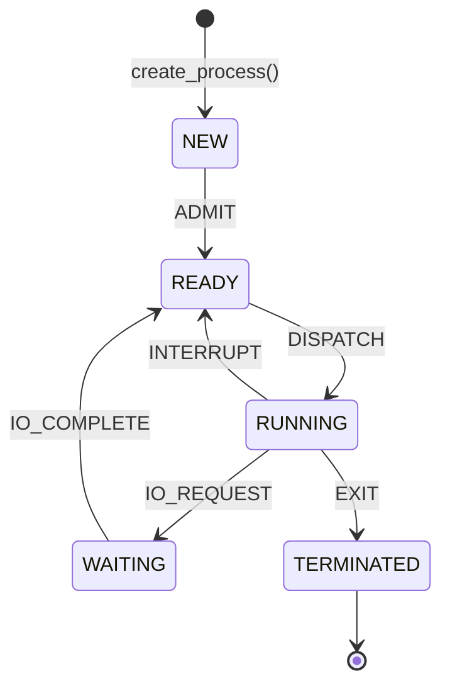

# State Transition Diagram

## Transition table (the six legal transitions)

| Current state | Action        | Next state  |
|---------------|---------------|-------------|
| NEW           | `ADMIT`       | READY       |
| READY         | `DISPATCH`    | RUNNING     |
| RUNNING       | `INTERRUPT`   | READY       |
| RUNNING       | `IO_REQUEST`  | WAITING     |
| WAITING       | `IO_COMPLETE` | READY       |
| RUNNING       | `EXIT`        | TERMINATED  |

Every other (state, action) pair is rejected with `SIM_ERR_INVALID_TRANSITION`.
TERMINATED is a final state: no action leaves it.

## Diagram (Mermaid)

Mermaid renders in GitHub and in VS Code (with a Markdown preview extension
that supports Mermaid).



## Diagram (plain text, works everywhere)

```
      +-----+  ADMIT   +-------+  DISPATCH  +---------+  EXIT   +------------+
 ---->| NEW |--------->| READY |----------->| RUNNING |-------->| TERMINATED |
      +-----+          +-------+            +---------+         +------------+
                         ^   ^                 |   |
                         |   +---- INTERRUPT --+   |
                         |                         | IO_REQUEST
                         | IO_COMPLETE             v
                         |                    +---------+
                         +--------------------| WAITING |
                                              +---------+
```

## Examples of rejected transitions

| Attempt                  | Why it is rejected                                  |
|--------------------------|-----------------------------------------------------|
| NEW + `DISPATCH`         | A process must be admitted (READY) before running.  |
| READY + `IO_REQUEST`     | Only a RUNNING process can ask for I/O.             |
| WAITING + `EXIT`         | A waiting process must return to READY first.       |
| TERMINATED + any action  | TERMINATED is final.                                |
